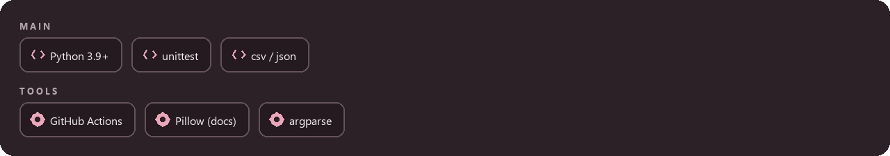
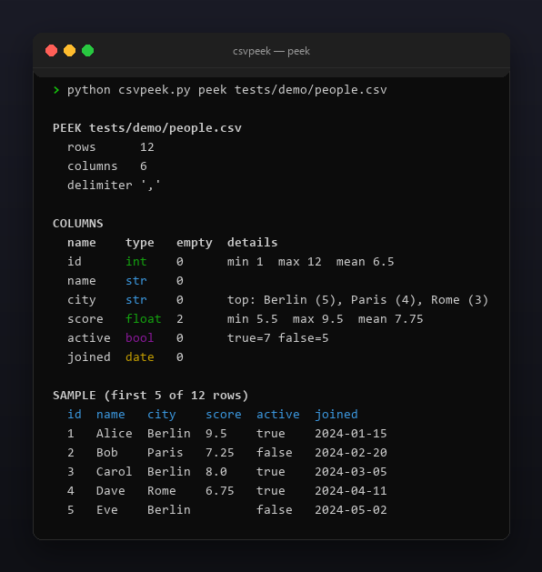
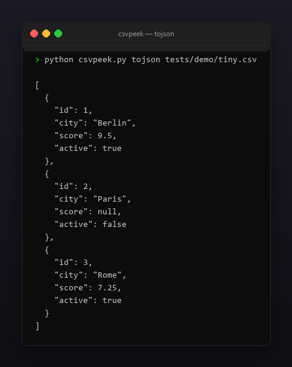

<p align="center"></p>

<p align="center">
  <a href="README.ru.md"></a>
  <a href="https://github.com/Celine1337/csvpeek/releases"></a>
  <a href="https://github.com/Celine1337/csvpeek/actions/workflows/ci.yml"></a>
  <a href="LICENSE"></a>
</p>


Quick profiler and converter for CSV files. Before you load a CSV into a
notebook or a database, csvpeek tells you what is actually inside: how many
rows and columns, which type each column looks like, where the nulls are,
numeric ranges and means, the most frequent values of low-cardinality text
columns, and the first rows as an aligned table. It also converts CSV to a
JSON array of row objects and back.

Single file, standard library only, Python 3.9+, no network.


- `peek`: row/column counts, per-column inferred type (`int` / `float` /
  `bool` / `date` / `str`), empty/null counts, min/max/mean for numeric
  columns, top-3 values with counts for low-cardinality `str` columns, and
  the first N sample rows (default 5) as an aligned table.
- `tojson`: JSON array of row objects; numbers and bools coerced per inferred
  column type, nulls become `null`, dates stay strings.
- `tocsv`: CSV from a JSON array of objects; header is the union of keys in
  first-seen order, missing keys become empty cells.
- Quoted fields, embedded newlines and custom delimiters (`--delimiter`,
  `\t` supported); UTF-8 with optional BOM.
- `--json` on `peek` emits the whole profile as a machine-readable struct;
  colored ANSI output with `--no-color` and `NO_COLOR`.


| Mode | Command | Output |
|------|---------|--------|
| peek | `csvpeek.py peek FILE.csv [--delimiter D] [--rows N] [--json]` | profile + aligned sample table, or JSON profile struct |
| tojson | `csvpeek.py tojson FILE.csv [--delimiter D]` | JSON array of row objects with coerced types |
| tocsv | `csvpeek.py tocsv FILE.json [--delimiter D]` | CSV text, union of keys as header |

Type inference is a heuristic: parsers are tried in order over the non-empty
values of a column, and the first one that fits **every** value wins.

| Type | Rule |
|------|------|
| int | `[+-]?` digits only |
| float | decimal / exponent notation (`2.5`, `.5`, `1e3`) |
| bool | `true` / `false` / `yes` / `no`, case-insensitive |
| date | `YYYY-MM-DD`, `YYYY/MM/DD`, `DD.MM.YYYY`, `MM/DD/YYYY`, `YYYY-MM-DDTHH:MM:SS`, `YYYY-MM-DD HH:MM:SS` |
| str | fallback (also for all-empty columns) |

Empty/null means `""`, `null`, `none`, `na`, `n/a`, `nan` (case-insensitive,
whitespace-stripped). A `str` column is low-cardinality at ≤ 10 distinct
values; its top-3 is sorted by count, then alphabetically.





```console
$ python csvpeek.py peek tests/demo/people.csv
$ python csvpeek.py peek data.tsv --delimiter '\t' --rows 10
$ python csvpeek.py peek data.csv --json
$ python csvpeek.py tojson data.csv > data.json
$ python csvpeek.py tocsv data.json > back.csv
```

```
PEEK tests/demo/people.csv
  rows      12
  columns   6
  delimiter ','

COLUMNS
  name    type   empty  details
  id      int    0      min 1  max 12  mean 6.5
  name    str    0
  city    str    0      top: Berlin (5), Paris (4), Rome (3)
  score   float  2      min 5.5  max 9.5  mean 7.75
  active  bool   0      true=7 false=5
  joined  date   0

SAMPLE (first 5 of 12 rows)
  id  name   city    score  active  joined
  1   Alice  Berlin  9.5    true    2024-01-15
  2   Bob    Paris   7.25   false   2024-02-20
  3   Carol  Berlin  8.0    true    2024-03-05
  4   Dave   Rome    6.75   true    2024-04-11
  5   Eve    Berlin         false   2024-05-02
```

Exit codes: `0` — success, `1` — reserved, `2` — bad input or path (missing
file, malformed CSV, ragged rows, invalid JSON, bad delimiter).

Limits, on purpose: type inference is heuristic, not semantic — `0`/`1`
columns are `int`, not `bool`; `DD.MM.YYYY` vs `MM/DD/YYYY` is ambiguous and
resolved per value by format order; dates are kept as strings in `tojson`.
The whole file is read into memory (no streaming). Blank lines are skipped,
but any other row with a wrong field count is rejected as malformed, and
duplicate header names block `tojson` (they cannot map to JSON objects).







```console
$ python -m unittest discover -s tests -v
```

55 tests cover inference, profiling, both converters, quoting, delimiters and
every exit path. The demo fixtures and all images are regenerable:

```console
$ pip install pillow
$ python tools/make_shots.py      # docs/peek.png, docs/convert.png
$ python tools/make_style.py tools/style.json docs/style
```


[MIT](LICENSE) © Celine1337