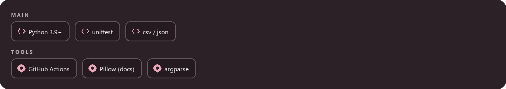
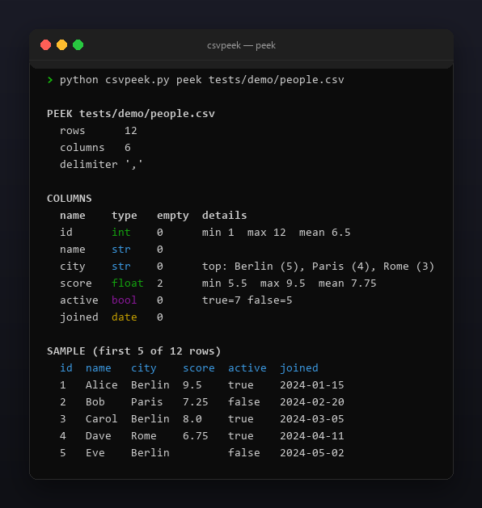
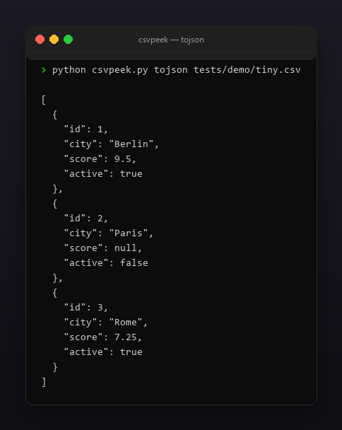

<p align="center"></p>

<p align="center">
  <a href="README.md"></a>
  <a href="https://github.com/Celine1337/csvpeek/releases"></a>
  <a href="https://github.com/Celine1337/csvpeek/actions/workflows/ci.yml"></a>
  <a href="LICENSE"></a>
</p>


Быстрый профилировщик и конвертер CSV. Прежде чем грузить CSV в ноутбук или
базу, csvpeek показывает, что внутри: сколько строк и колонок, какого типа
каждая колонка, где пустые значения, диапазоны и средние для чисел, самые
частые значения текстовых колонок с низкой кардинальностью и первые строки
выровненной таблицей. Ещё умеет конвертировать CSV в JSON-массив объектов и
обратно.

Один файл, только стандартная библиотека, Python 3.9+, без сети.


- `peek`: число строк/колонок, выведенный тип каждой колонки (`int` / `float` /
  `bool` / `date` / `str`), счётчики пустых/null, min/max/mean для числовых
  колонок, топ-3 значения со счётчиками для `str`-колонок с низкой
  кардинальностью и первые N строк (по умолчанию 5) выровненной таблицей.
- `tojson`: JSON-массив объектов-строк; числа и bool приводятся по выведенному
  типу колонки, null становятся `null`, даты остаются строками.
- `tocsv`: CSV из JSON-массива объектов; заголовок — объединение ключей в
  порядке первого появления, отсутствующие ключи становятся пустыми ячейками.
- Кавычки, встроенные переносы строк и свои разделители (`--delimiter`,
  поддерживается `\t`); UTF-8 с необязательным BOM.
- `--json` у `peek` отдаёт весь профиль машинно-читаемой структурой; цветной
  ANSI-вывод с `--no-color` и `NO_COLOR`.


| Режим | Команда | Вывод |
|-------|---------|-------|
| peek | `csvpeek.py peek FILE.csv [--delimiter D] [--rows N] [--json]` | профиль + выровненная таблица строк или JSON-структура профиля |
| tojson | `csvpeek.py tojson FILE.csv [--delimiter D]` | JSON-массив объектов-строк с приведением типов |
| tocsv | `csvpeek.py tocsv FILE.json [--delimiter D]` | CSV-текст, объединение ключей как заголовок |

Вывод типов — эвристика: парсеры пробуются по порядку на непустых значениях
колонки, побеждает первый, подходящий **всем** значениям.

| Тип | Правило |
|-----|---------|
| int | только `[+-]?` и цифры |
| float | десятичная / экспоненциальная запись (`2.5`, `.5`, `1e3`) |
| bool | `true` / `false` / `yes` / `no`, без учёта регистра |
| date | `YYYY-MM-DD`, `YYYY/MM/DD`, `DD.MM.YYYY`, `MM/DD/YYYY`, `YYYY-MM-DDTHH:MM:SS`, `YYYY-MM-DD HH:MM:SS` |
| str | fallback (и для полностью пустых колонок) |

Пустое/null — это `""`, `null`, `none`, `na`, `n/a`, `nan` (без учёта регистра
и пробелов по краям). `str`-колонка считается низкокардинальной при ≤ 10
различных значениях; её топ-3 сортируется по счётчику, затем по алфавиту.





```console
$ python csvpeek.py peek tests/demo/people.csv
$ python csvpeek.py peek data.tsv --delimiter '\t' --rows 10
$ python csvpeek.py peek data.csv --json
$ python csvpeek.py tojson data.csv > data.json
$ python csvpeek.py tocsv data.json > back.csv
```

```
PEEK tests/demo/people.csv
  rows      12
  columns   6
  delimiter ','

COLUMNS
  name    type   empty  details
  id      int    0      min 1  max 12  mean 6.5
  name    str    0
  city    str    0      top: Berlin (5), Paris (4), Rome (3)
  score   float  2      min 5.5  max 9.5  mean 7.75
  active  bool   0      true=7 false=5
  joined  date   0

SAMPLE (first 5 of 12 rows)
  id  name   city    score  active  joined
  1   Alice  Berlin  9.5    true    2024-01-15
  2   Bob    Paris   7.25   false   2024-02-20
  3   Carol  Berlin  8.0    true    2024-03-05
  4   Dave   Rome    6.75   true    2024-04-11
  5   Eve    Berlin         false   2024-05-02
```

Коды возврата: `0` — успех, `1` — зарезервирован, `2` — плохие данные или путь
(нет файла, сломанный CSV, неровные строки, невалидный JSON, плохой разделитель).

Ограничения сознательные: вывод типов эвристический, не семантический —
колонки `0`/`1` это `int`, а не `bool`; `DD.MM.YYYY` против `MM/DD/YYYY`
неоднозначно и решается порядком форматов для каждого значения; даты в
`tojson` остаются строками. Файл читается в память целиком (без стриминга).
Пустые строки пропускаются, но любая другая строка с неверным числом полей
отклоняется как сломанная, а дубликаты имён колонок блокируют `tojson`
(их нельзя отобразить в JSON-объекты).







```console
$ python -m unittest discover -s tests -v
```

55 тестов покрывают вывод типов, профилирование, оба конвертера, кавычки,
разделители и все пути выхода. Демо-фикстуры и все картинки перегенерируются:

```console
$ pip install pillow
$ python tools/make_shots.py      # docs/peek.png, docs/convert.png
$ python tools/make_style.py tools/style.json docs/style
```


[MIT](LICENSE) © Celine1337